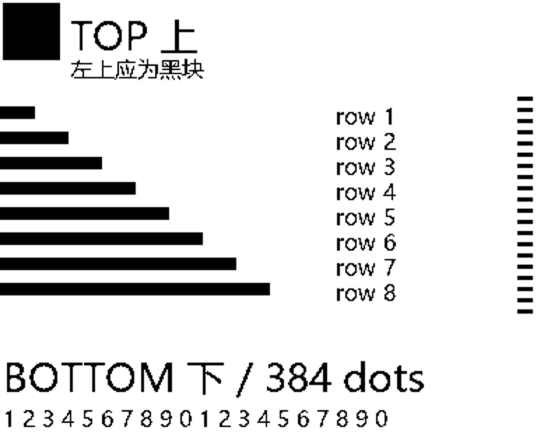
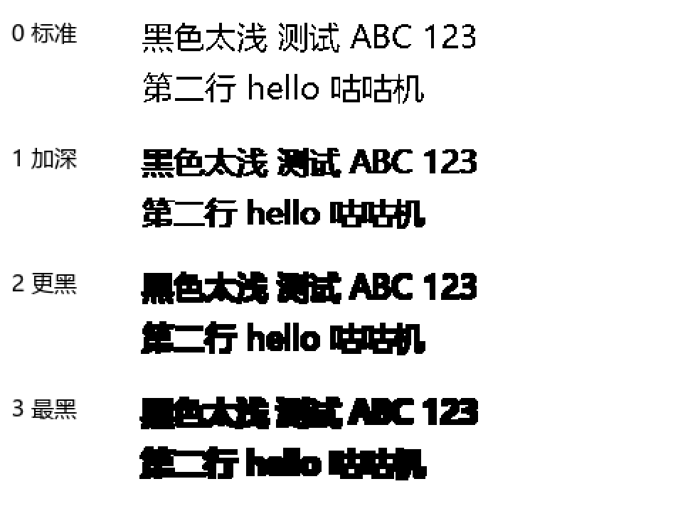

# memobird-printer — 咕咕机 / 有道口袋打印机 通用控制

逆向 `cn.memobird.XGWangYi`（有道打印机 v3.2.9，咕咕机团队「厦门盈点科技」出品）之后做的
**三套互相独立的实现 + 一个共用库**。热敏打印头 384 点，走 `AA|LEN|CMD|TLV|SUM` 私有协议。

## 三个实现（区别只有一条：蓝牙在谁手里）

| | 蓝牙在 | 需要什么 | 跑在 | 文档 |
|---|---|---|---|---|
| **1. 纯静态网页** | 浏览器 | 只要一个 https 页面 | 任何静态托管 / GitHub Pages | [apps/static-web](apps/static-web/README.md) |
| **2. 网页 + 编码服务** | 浏览器 | `python3` + Pillow | 手机 Termux（免 root） | [apps/web-server](apps/web-server/README.md) |
| **3. 打印服务** | **Python 进程** | `python3` + `bleak`/`pyserial` | PC / 树莓派 / NAS | [apps/print-server](apps/print-server/README.md) |

* **1 和 2**：浏览器持有 BLE 连接，Python 只是"编码器"（把文字/图片变成帧）。
  区别是编码器在浏览器（1）还是 Python（2）。
* **3**：Python 自己连打印机，对外只暴露 HTTP —— 任何脚本、cron、Home Assistant 都能打印。
  必须跑在有蓝牙适配器的机器上。

三套可以同时用，互不依赖：各自目录自包含（含自己的 `vendor/`），删掉另外两套也照常工作。

| 文字点阵（384 点宽） | 校准图（判断方向/丢行） | 浓度档位对比 |
|---|---|---|
|  |  |  |

## 目录结构

```
memobird_printer/          # 共用库：协议帧、图像、BLE/SPP/LAN/云 四种后端、CLI
shared/web/                # 共用前端源码（编码器 / canvas 渲染 / GBK 码表 / BLE 传输 / 样式）
apps/
├── static-web/            # 实现 1（单文件静态页，build.py 产出 docs/index.html）
├── web-server/            # 实现 2（serve.py + 页面 + 部署脚本）
└── print-server/          # 实现 3（HTTP 打印服务 + 命令行客户端）
docs/                      # 协议说明 / 逆向报告 / 为什么用 Web Bluetooth / Pages 产物
tests/                     # 41 项 JS↔Python 逐字节 + 24 项协议 + 17 项 BLE + 21 项浏览器端到端 + 23 项打印服务
tools/                     # 生成夹具/码表、同步 vendor、打包、抓包、APK 静态分析
```

## 快速开始

```bash
git clone <本仓库> && cd memobird-pocket-printer
python -m pip install pillow requests          # 共用库最小依赖
```

**1. 纯静态版**（零后端，推荐先试）

```bash
python tools/sync_vendor.py && python apps/static-web/build.py     # → docs/index.html
python -m http.server 8000                     # 手机 Chrome 打开 http://127.0.0.1:8000
```

或仓库 → Settings → Pages → Branch `main` / 目录 `/docs` → 访问 `https://<你>.github.io/<仓库>/`。

**2. 网页 + 编码服务**（手机 Termux）

```bash
python3 apps/web-server/doctor.py              # 部署前自检
python3 apps/web-server/serve.py               # → http://127.0.0.1:8000
```

**3. 打印服务**（PC / 树莓派）

```bash
python apps/print-server/server.py --backend ble --target AA:BB:CC:DD:EE:FF --port 8100
curl -X POST http://127.0.0.1:8100/print -d '{"text":"服务器磁盘 85%","darken":1}'
```

## 共用库 `memobird_printer`

```python
from memobird_printer import LanPrinter, prepare, dither_to_raw

p = LanPrinter("192.168.1.50")
p.print_text("hello 咕咕机")
p.print_raw_image(*dither_to_raw(prepare("photo.png"), "floyd"))
```

命令行（不经网页、不经服务，直接打）：

```bash
python -m memobird_printer selftest                      # 无硬件自检
python -m memobird_printer lan-scan                      # 扫局域网打印机
python -m memobird_printer text "hi" --lan 192.168.1.50
python -m memobird_printer scan                          # 扫蓝牙
python -m memobird_printer gatt AA:BB:CC:DD:EE:FF        # 看 GATT 表
python -m memobird_printer image p.png --ble AA:BB:..    # BLE 直打（bleak）
python -m memobird_printer text "hi" --spp COM5          # 经典蓝牙
python -m memobird_printer preview "文本" -o p.png       # 本地看抖动效果
```

| 模块 | 内容 |
|---|---|
| `packet.py` | `AA|LEN|CMD|TLV|SUM` 帧、TLV 编解码、文本/位图任务、走纸帧 |
| `image.py` | 384 点宽 1bpp、Floyd/Atkinson/Bayer/阈值、浓度档位（阈值+笔画膨化）、官方格式 BMP |
| `ble.py` | BLE GATT（bleak）+ 经典蓝牙 SPP（pyserial） |
| `lan.py` | WiFi 机型 `http://<ip>/sys/printer` |
| `cloud.py` | 咕咕机开放平台 `open.memobird.cn` |

## 版本

* Python 库 / CLI：**1.1.0**（`python -m memobird_printer --version`）
* 静态网页：**1.1.0** · 服务端网页：**2.1.0** · 打印服务：**1.1.0**
* 详见 [`docs/更新日志.md`](docs/更新日志.md)

## 底层操作（固件能做的都能驱）

```bash
python -m memobird_printer raw  aa01000154 --ble <地址>          # 发任意帧
python -m memobird_printer cmd  0x08 --ble <地址>                # 发命令
python -m memobird_printer cmd  0x03 --tlv 0x02:6 --ble <地址>   # 写浓度
python -m memobird_printer notify --seconds 15 --ble <地址>      # 监听通知
python -m memobird_printer gatt-read --list --ble <地址>         # 列 GATT
```

HTTP：`POST /raw`、`POST /cmd`、`GET /gatt`；网页调试页有「底层操作」面板。

## 定时 / 远程打印

```bash
python apps/print-server/server.py --backend ble --target 00:15:83:E4:7A:F2 --port 8100 --jobs-file jobs.json

curl -X POST localhost:8100/jobs -d '{"text":"开会提醒","delaySec":60}'      # 60 秒后打
curl -X POST localhost:8100/jobs -d '{"text":"日报","repeatSec":3600}'      # 每小时打
curl localhost:8100/jobs                                                    # 看队列
curl -X DELETE localhost:8100/jobs/<id>                                     # 取消
```

任务会先检查**缺纸**（缺纸就等，不白打）、失败重试 3 次、支持 `--jobs-file` 落盘。

## 设备信息（真机实测）

```bash
python -m memobird_printer info    --ble 00:15:83:E4:7A:F2          # 序列号 + 状态字
python -m memobird_printer setting --ble <地址> --tag 0x03 --value 1  # 开指示灯
python tools/bt_probe.py full <地址>                                  # 一次连接读全部 + 扫命令
```

| 能读到 | 能写 |
|---|---|
| 序列号（`0x0F`）、指示灯状态（`0x03`）、**缺纸标志（`0x06`）**、`0x02` 设置项、`0x04` 电压类读数、`0x13` 标志位 | 指示灯 `0x03`（0/1）、`0x02`（1..60，含义待定） |

**缺纸能检测出来**（`0x06`：有纸 0 / 缺纸 1，实机把纸抽出来验证过）——
打印服务可以带 `"checkPaper": true`，缺纸直接 409，不会白打一帧。

**电量可以估算**：固件不直接给百分比，但 `0x04` 是**电池电压**（0.05 V/LSB）——
实测未充电 74(3.70V)、插电充电后 79~80(3.95~4.00V)、负载时下掉。
`device.battery_percent()` 用锂电静置曲线换算成百分比（±10%，负载时偏低）。

`0x01=23` 对充电、满载打印、捂热电池、写入全都不变 → 是固件常量，不是传感器。

`0x02` **不是自动关机时间**（设成 1 分钟、断开静置 100 秒仍在线）；
标准 `0x180A` 报的是蓝牙模组信息（`ISSC / BT5050 / 5050_SPP / 2030030`），
也没有 `0x180F` 电池服务。

细节、命令表、以及两个坑（**通知会拆片**、**订阅后第一包是上次连接的残留**）
见 [`docs/协议说明.md`](docs/协议说明.md) 第 1.7 节。

## 已经踩过的坑（都写在文档里了）

| 坑 | 现象 | 真相 |
|---|---|---|
| BMP `biHeight` 取负 | 打出自带的 `nice to meet you` 示范页 | 官方是**正高度 + 行序 top-down + 调色板 index0=黑**，与 PIL 字节一致 |
| 裸位图帧 | 不出纸 | `tag 0x08` 必须是**完整 BMP 文件**，只发像素固件不知道宽高 |
| 字号档位 `tag 0x10` | 字号怎么调都一样 | GT1 忽略固件档位；要字号就走位图 |
| 文本不分包 | 末尾出现怪符号 | 官方每包 ≤300 字节，超了会解析错位 |
| "打印太浅" | 灰蒙蒙 | 九成是**纸/电量**，不是软件（`electro-sensitive 纸受潮、装反、低电量都会变浅`）|

协议细节见 [`docs/协议说明.md`](docs/协议说明.md)，逆向过程见 [`docs/逆向报告.md`](docs/逆向报告.md)，
`docs/手机端WebBluetooth.md` 讲清了"为什么浏览器必须持有蓝牙"这件事。

## 验证矩阵

不接打印机也能跑：

```bash
python -m memobird_printer selftest     # 帧/BMP/依赖
python tests/test_protocol.py           # 24 项：帧向量、TLV、BMP 与 PIL 逐字节、云端编码
node   tests/test_encoder_js.js         # 41 项：JS 编码器 ↔ Python 逐字节（含浓度档位）
node   tests/test_ble_util.js           # 17 项：BLE 选特征值（兼容新旧 Chrome API）
python tests/test_static_page.py        # 21 项：真 Chrome + CDP 跑实现 1（file://、零后端）
python tests/test_print_server.py       # 23 项：实现 3 的逻辑 + HTTP + API key
python tools/sync_vendor.py --check     # 两个网页实现的 vendor 与 shared/web 一致
```

CI（GitHub Actions）在 3 个 Python 版本上跑全部测试，并校验
`tests/fixtures.json`、`shared/web/gbk.js`、`docs/index.html` 与源码一致（生成物可重现）。

> 真机只在 **GT1** 上验证过（BLE、384 点、BMP 通道、浓度、走纸、校准图）。
> 其他机型按协议应兼容，但没实测 —— 欢迎反馈 GATT 表和校准图结果。

## 许可

MIT。仅为**互操作性**与个人学习：让自己的设备和自己拥有的打印机直接通信。
仓库**不包含**原 App 的任何代码/资源/安装包；协议信息来自公开资料与官方开放平台文档
（出处逐条列在 `docs/协议说明.md` 第 6 节）。请勿用于绕过付费、授权或内容审核机制。
