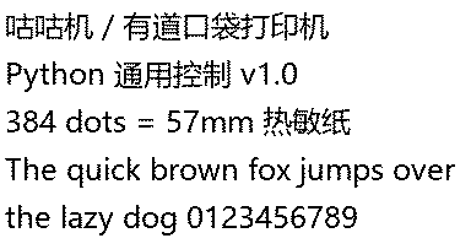

# memobird_printer — 咕咕机 / 有道口袋打印机 通用 Python 控制库

> 逆向 `cn.memobird.XGWangYi`（有道打印机 v3.2.9，咕咕机团队「厦门盈点科技」出品）后写的
> 一套纯 Python 打印控制库。目标不是"能跑一次"，而是**换任何一台同系列热敏打印机都能用**。
>
> 三条通道：**蓝牙 BLE**（有道口袋打印机 / GT1 / GO / G4）、**局域网 HTTP**（WiFi 机型，免账号）、
> **云端开放平台**（兜底）。附带一个 **手机端 Web Bluetooth 网页控制台**（Termux 里跑 Python 即可，
> 不需要 root、不需要 BlueZ、不用碰 App 的私有协议）。

```
memobird_printer/
├── image.py    文本/图片 → 384 点宽 1bpp 位图（Floyd/Atkinson/Bayer 抖动、自写 BMP）
├── packet.py   蓝牙帧 AA|LEN|CMD|TLV|SUM 与 TLV 编解码
├── lan.py      局域网 HTTP 后端 http://<ip>/sys/printer
├── ble.py      BLE GATT（bleak）+ 经典蓝牙 SPP（pyserial COM 口）
├── cloud.py    咕咕机开放平台 open.memobird.cn
└── cli.py      命令行

web/            网页控制台（两种跑法见下）
├── index.html  页面骨架
├── app.js      UI + Web Bluetooth 传输 + 双模式调度
├── encoder.js  纯 JS 编码器（帧/TLV/抖动/BMP），与 Python 逐字节等价
├── render.js   canvas 渲染（文字/图片/校准图 → 灰度）
└── gbk.js      GBK 码表（自动生成，21791 个码位，79 KB）
phone/serve.py  本地服务：页面 + 编码 API（Python 做编码，浏览器只搬字节）
```

**两种跑法，同一份代码：**

| 跑法 | 编码在哪 | 需要什么 | 适用于 |
|---|---|---|---|
| **服务端模式** | Python + Pillow | `phone/serve.py` + `python3-pil` | 手机 Termux 里跑，图像质量最好、可离线 |
| **纯静态模式** | 浏览器（encoder.js） | 只要一个 https 或 localhost 页面 | GitHub Pages / 任何静态托管，零后端 |

两种模式下**蓝牙传输完全一样**（都是 Web Bluetooth），差别只在编码：静态模式里文字也能走 GBK 帧（靠内嵌码表），所以速度不会退化。

| 文字预览 | Atkinson 抖动 | 校准图 |
|---|---|---|
|  |  |  |

## 安装

```powershell
python -m pip install pillow requests bleak pyserial
# 可选：抓 App 私有接口用
python -m pip install mitmproxy
```

## 30 秒自检（不需要打印机）

```powershell
cd <项目目录>
python -m memobird_printer selftest      # 库自检
python tests\test_protocol.py            # 24 项离线断言（帧/JSON/GBK/BMP）
```

自检把本库生成的蓝牙帧**逐字节**跟公开文档里的实测报文比对，并验证 BMP 能被标准解码器回读：

```
[OK ] LED 开          aa0500030301000149
[OK ] 读状态          aa01000154
[OK ] 打印头 3 个 TLV  aa1000040b020005000c020001000a02002900ec
渲染: 384x47px  raw=2256B  BMP: 2318B biHeight=-47 (top-down)
```

## 三种连接方式

### 1) 局域网直连（WiFi 机型：G2/T2/G3/G5…，**无需账号、无需 ak**）

```powershell
python -m memobird_printer lan-scan                    # 扫同网段打印机
python -m memobird_printer status --lan 192.168.1.50
python -m memobird_printer text "晚上 8 点开会" --lan 192.168.1.50
python -m memobird_printer image photo.jpg --lan 192.168.1.50 --mode floyd
```

```python
from memobird_printer import LanPrinter, prepare, dither_to_raw
p = LanPrinter("192.168.1.50")
p.print_text("hello 咕咕机")
p.print_raw_image(*dither_to_raw(prepare("photo.png"), "atkinson"))
```

### 2) 蓝牙（有道口袋打印机 / GT1 / GO / G4）

```powershell
python -m memobird_printer scan                        # 找设备
python -m memobird_printer gatt AA:BB:CC:DD:EE:FF      # 看 GATT 表，找可写/可通知特征值
python -m memobird_printer text "蓝牙打印" --ble AA:BB:CC:DD:EE:FF
python -m memobird_printer image photo.jpg --ble AA:BB:CC:DD:EE:FF
```

```python
import asyncio
from memobird_printer import BlePrinter, prepare, dither_to_raw

async def main():
    async with BlePrinter("AA:BB:CC:DD:EE:FF") as b:
        await b.print_text("蓝牙打印")
        await b.print_raw_image(dither_to_raw(prepare("photo.png"))[2])

asyncio.run(main())
```

Android 侧走经典蓝牙的机型（G4 等）：在 Windows 上配对后会生成 COM 口，用 SPP 后端：

```powershell
python -m memobird_printer text "经典蓝牙" --spp COM5
```

### 3) 云端开放平台（兜底，需要申请 ak）

```powershell
python -m memobird_printer cloud-bind --ak YOUR_AK --device 9d15e1b2671043ee --ident myname
python -m memobird_printer cloud-text "hi" --ak YOUR_AK --device 9d15e1b2671043ee --userid 12345
```

## 图像处理

打印头 384 点、纸宽 57mm。`prepare()` 负责渲染/缩放，`dither_to_raw()` 负责二值化：

| 参数 | 说明 |
|---|---|
| `mode="floyd"` | 误差扩散，照片/渐变最自然（默认） |
| `mode="atkinson"` | 对比更高、颗粒更干净，小字/线稿好 |
| `mode="bayer"` | 有序抖动，网点规则，适合图案 |
| `mode="threshold"` | 纯阈值，纯文字/黑白图最快最锐 |
| `font` / `font_size` | 中文默认用微软雅黑，可指定任意 ttf/ttc |

```powershell
python -m memobird_printer preview "本地先看效果" -o p.png --mode atkinson
```

## 📱 手机端网页控制（Termux proot Ubuntu + Chrome Web Bluetooth）

不用破解 App 私有协议，也不用 root：**Python 只做编码，Chrome 做蓝牙搬运**。

```bash
# Termux
pkg install -y proot-distro && proot-distro install ubuntu && proot-distro login ubuntu
apt update && apt install -y python3 python3-pil
cd ~/memobird-pocket-printer && python3 phone/serve.py     # 或 bash phone/run.sh
```

> 想少传点文件：电脑上跑 `python tools/make_phone_zip.py`，会打出 `memobird_phone.zip`（约 45 KB），
> 传到手机解压即可。

手机上用 **Chrome** 打开 `http://127.0.0.1:8000` → 点「连接打印机」→ 选设备 → 输入文字 → 打印。

* 文字默认走 **GBK 文本帧**：一行字 1 帧几十字节，秒出
* 图片走 BMP 分片（384×320 ≈ 15KB，20B/写约 10–20 秒）
* 调试页有 **打印校准图**（判断上下/左右/丢行）、**探测 GATT**（型号不符时定位特征值）、
  写入分片大小、预热开关
* 为什么必须 BLE：有道打印机有 iOS 版，而 iOS 不开放经典蓝牙 SPP → 硬件必然支持 BLE
* 必须用 `127.0.0.1`/`localhost` 打开（Web Bluetooth 要求安全上下文）

完整步骤见 **[`docs/部署文档.md`](docs/部署文档.md)**（部署/自检/后台常驻/校准/排错全套），
设计取舍与原理见 [`docs/手机端WebBluetooth.md`](docs/手机端WebBluetooth.md)。

## 🌐 纯静态版（GitHub Pages，零后端）

同一份 `web/` 可以打成**单文件**静态页，直接挂 Pages：

```bash
python tools/build_static.py      # → docs/index.html（约 120 KB，gzip 64 KB）
```

启用后访问 `https://<用户名>.github.io/<仓库名>/`
（仓库 → Settings → Pages → Source: *Deploy from a branch* → Branch: `main` / `docs` → Save）

| 特点 | 说明 |
|---|---|
| 零后端 | 手机 Chrome 直接开 URL，不需要 Termux / 服务端 / root |
| 编码在浏览器 | canvas 渲染 + `encoder.js` 抖动封帧 + 内嵌 GBK 码表（79 KB） |
| 文字仍然快 | 走 GBK 帧 1–4 次写，速度和服务端模式一样 |
| 代价 | 图片缩放用 canvas（略逊 Pillow 的 LANCZOS）；页面首屏需联网（**打印内容不外发**） |

已用真 Chrome 验证（`python tests/test_static_page.py`，`file://` 打开、零服务端，18 项断言）：
页面自动切到浏览器编码、浏览器生成的「你好」GBK 帧与 Python **逐字节相同**、校准图与码表可用。

## 抓 App 自己的私有接口（可选）

App 被 360 加固、dex 全加密，接口只能动态拿：

```powershell
mitmdump -s tools/mitm_capture.py
# 手机 WiFi 代理指向 PC:8080 → 访问 mitm.it 装证书 → 打开 App 打一张
# 结果写进 capture.jsonl（域名/路径/参数/响应全记录）
```

## 已验证 / 未验证

* 已验证：蓝牙帧结构与校验和（对齐 3 条文档实测报文）、TLV 编解码、384 点渲染、
  Floyd/Atkinson 抖动、BMP 生成（PIL 回读逐像素一致，`biHeight` 为负即 top-down）、
  蓝牙分帧上限。
* 未验证：真机连通（本机没有打印机/Android 设备）。局域网 JSON 字段与云端参数
  来自公开实测记录，不同固件版本可能差异。
* 详细协议与逆向结论见 [`docs/协议说明.md`](docs/协议说明.md)、[`docs/逆向报告.md`](docs/逆向报告.md)。

## 许可

MIT。仅为**互操作性**与个人学习：让自己的设备和自己拥有的打印机直接通信。

仓库**不包含**原 App 的任何代码/资源/安装包；协议信息来自公开发布的资料与官方开放平台文档
（出处逐条列在 `docs/协议说明.md` 第 6 节）。请勿用于绕过付费、授权或内容审核机制。

